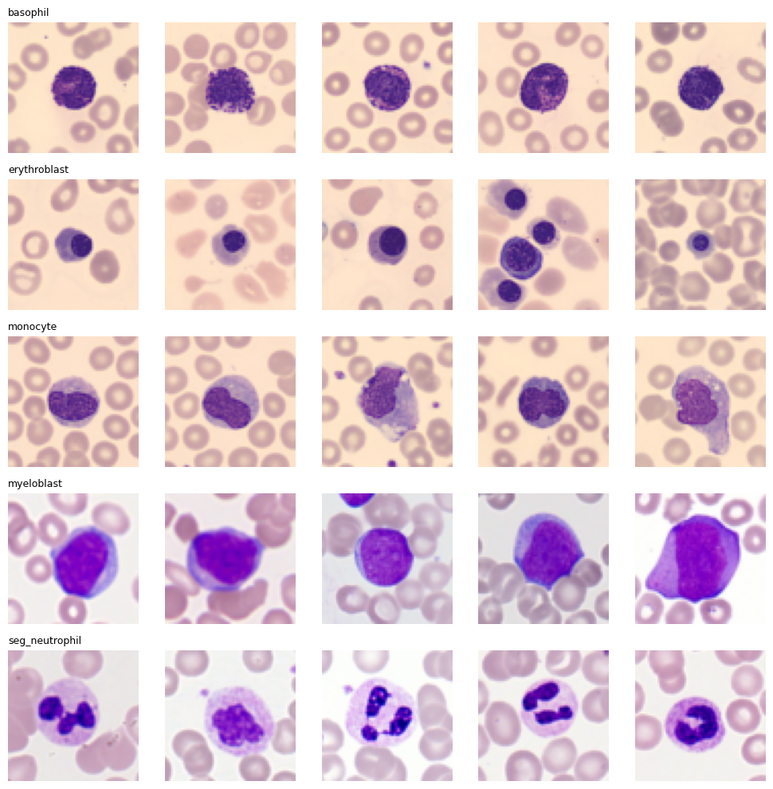
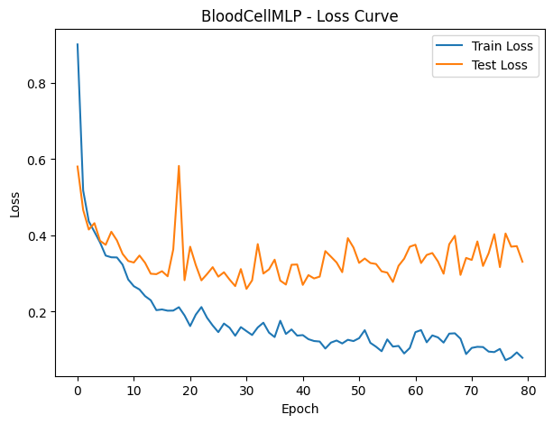
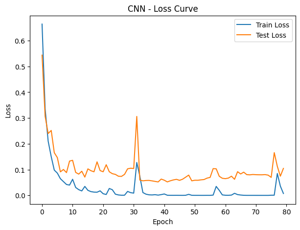
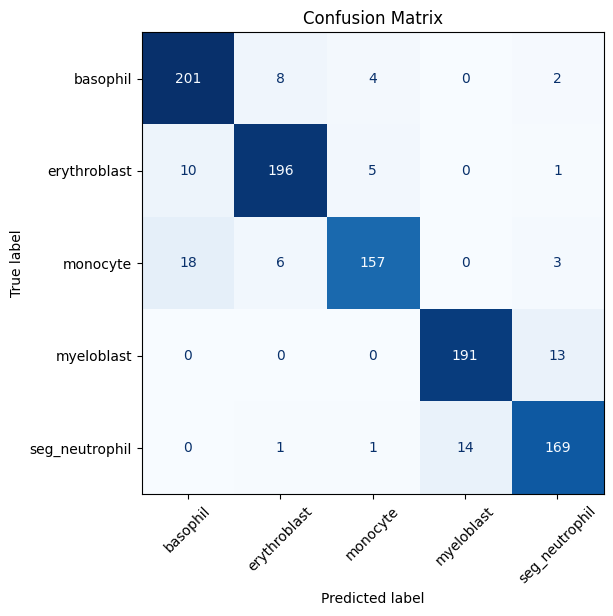
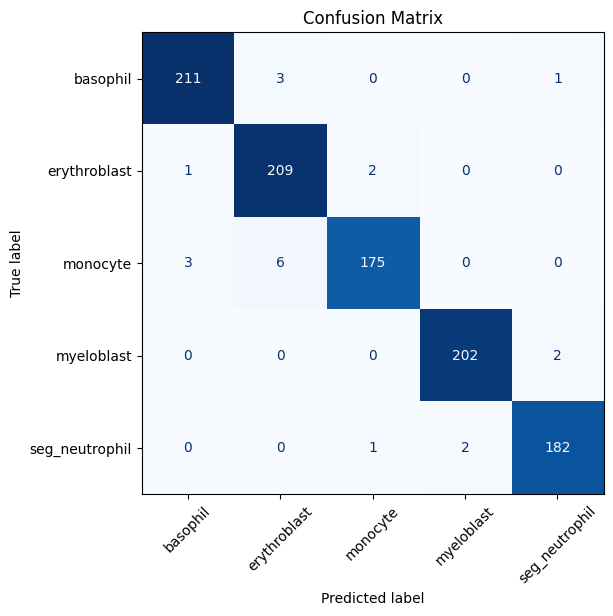
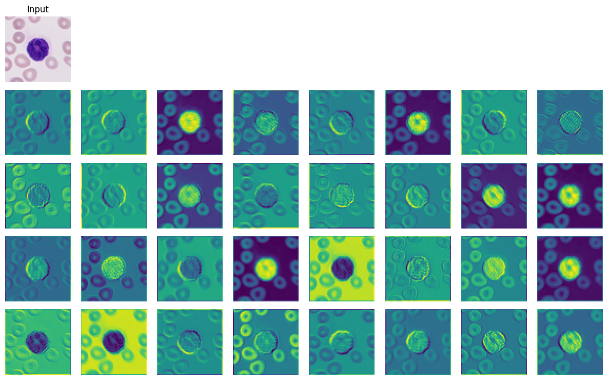
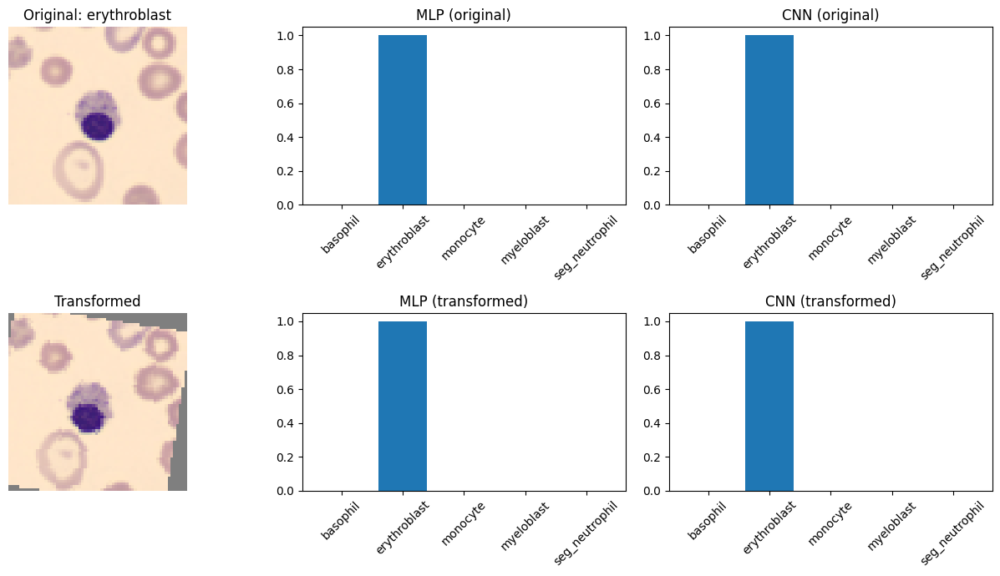

# Blood Cell Classification: MLP vs CNN

A head-to-head comparison of a fully connected network and a convolutional
network on 5-class blood cell image classification, trained under identical
conditions so the only thing that differs is architecture. Includes a full
interpretability pass — saliency maps, feature maps, occlusion heatmaps, and
a rotation/translation robustness test — to see *why* one architecture wins,
not just by how much.



## The setup

Both models see the same 5,000-image dataset (1,000 images per class:
basophil, erythroblast, monocyte, myeloblast, seg_neutrophil), the same
80/20 train/test split with a fixed seed, the same cross-entropy loss, and
the same ~3.5M parameter budget. Each one was picked via a small grid search
— 32 configurations for the MLP, 24 for the CNN — where every candidate got
a quick 10-epoch probing run before the winner was retrained for the full 80
epochs. The full probing log for the MLP search is in
[`results/mlp_grid_search_log.txt`](results/mlp_grid_search_log.txt).

## Results

| Model | Trainable Parameters | Test Accuracy | Macro F1 |
|---|---|---|---|
| MLP (`BloodCellMLP`) | 6,456,837 | 91.20% | 0.91 |
| CNN (`BloodCellCNN`) | 2,191,941 | 97.90% | 0.98 |

The CNN wins by almost 7 points while using a third of the MLP's
parameters, which is really the headline result here: weight sharing across
spatial positions is doing a lot of work on its own, independent of the
accuracy gap.

<table>
<tr>
<td></td>
<td></td>
</tr>
<tr>
<td></td>
<td></td>
</tr>
</table>

Both confusion matrices land most of their mistakes in the same place:
monocyte and basophil get confused with erythroblast more than any other
pair, which lines up with how visually similar those cell types are under
the microscope. The CNN just makes fewer of these mistakes overall.

## What the interpretability tests actually showed

I didn't want to stop at "CNN wins," so Parts 3 through 6 dig into *how*
each model is making decisions.

**Feature maps.** Hooking the CNN's first conv layer and looking at what
each filter responds to shows exactly what you'd expect from the textbook:
some channels have learned to trace the boundary between the cell and the
background, others pick up on coarse color/intensity contrast within the
cell body, and a few are still fairly flat and generic at this early depth.



**Saliency.** The MLP has no spatial feature maps to inspect, so its
counterpart is an input-gradient saliency map — the raw gradient of the
predicted class score with respect to every pixel. It's noticeably scattered
compared to the CNN's feature maps, often lighting up background pixels that
have nothing to do with the cell. That's a direct consequence of the
architecture: every input pixel connects to every hidden unit independently,
so there's no inductive bias pushing the model to respect the image's 2D
layout.

**Spatial robustness.** For each class I found a test image both models
already classified correctly, then applied a random rotation (up to 25°)
and translation (up to 15%) and re-ran both models on it.



The CNN barely notices. Its predicted class and confidence stay close to
where they started. The MLP is a lot more sensitive to the same
transformation — sometimes its confidence collapses, sometimes it flips to
a different predicted class entirely. Convolution's translation equivariance
plus max pooling's local invariance is doing real work here; the MLP has
neither.

**Occlusion.** Sliding an 8×8 gray patch across the image and watching how
much each position's removal hurts the true-class probability shows both
models paying most of their attention to the cell itself, especially the
nucleus, rather than the background — which is reassuring, since it means
neither model is cheating off some background artifact. The CNN's attention
is just more tightly focused on the nucleus specifically; the MLP's spreads
out over a wider area of the cell body.

## Part 7: how small can you go?

Parts 1 and 2 both use close to the full 3.5M parameter budget. Part 7 asks
the opposite question: swap the CNN's flatten-and-large-linear-layer head
for Global Average Pooling (which removes the term that was eating over 95%
of the CNN's parameters) and see how far under budget you can get. The
result is `TinyCNN`, at **6,197 parameters** — about 355x smaller than the
Part 2 CNN, and well under 0.2% of the budget. Run it yourself with
`scripts/run_experiment.py --model tiny_cnn`; the accuracy trade-off from
losing all spatial position information at the GAP step is worth seeing
first-hand rather than taking on faith.

## Project structure

```
blood-cell-mlp-vs-cnn/
├── data/                    # dataset lives here locally (gitignored, see data/README.md)
├── notebooks/
│   └── blood_cell_mlp_vs_cnn.ipynb   # original exploratory notebook
├── src/bloodcell/
│   ├── config.py             # DataConfig, TrainConfig, MLPConfig, CNNConfig, TinyCNNConfig
│   ├── data.py                # BloodCellDataModule, SampleVisualizer
│   ├── train.py                # ModelTrainer, count_trainable_params
│   ├── search.py                # GridSearchRunner
│   ├── models/                   # BloodCellMLP, BloodCellCNN, TinyCNN
│   └── interpret/                 # ErrorAnalyzer, FeatureMapVisualizer,
│                                    # MLPSaliencyVisualizer, SpatialInvarianceTester,
│                                    # OcclusionSensitivityAnalyzer
├── scripts/
│   ├── run_experiment.py     # train one model: grid search + full retrain
│   └── run_interpretability.py  # Parts 3-6 against two saved checkpoints
├── packages/torch-quickgrid/  # generic Trainer + GridSearch, spun out as its
│                                # own installable package (see its own README)
├── results/                  # grid search logs, checkpoints (checkpoints gitignored)
├── assets/                   # figures used in this README
└── requirements.txt
```

`src/bloodcell/train.py` and `src/bloodcell/search.py` don't import from
`packages/torch-quickgrid` — they're the dataset-specific originals, kept
as-is so this project has zero coupling to the generic package. `quickgrid`
is the same logic with the blood-cell-specific bits removed, packaged
separately because "generic training loop" and "blood cell classifier" are
two different things to hand someone, even if one grew out of the other.
See [`packages/torch-quickgrid/README.md`](packages/torch-quickgrid/README.md)
for its own usage docs and a runnable example.

## Getting started

```bash
git clone https://github.com/<your-username>/blood-cell-mlp-vs-cnn.git
cd blood-cell-mlp-vs-cnn
pip install -r requirements.txt
```

Put the dataset in `data/raw/<class_name>/*.jpg` — see
[`data/README.md`](data/README.md) for the exact layout. Then:

```bash
# Train the MLP: grid search + full 80-epoch retrain of the winner
python scripts/run_experiment.py --model mlp --save-checkpoint results/checkpoints/mlp.pt

# Train the CNN the same way
python scripts/run_experiment.py --model cnn --save-checkpoint results/checkpoints/cnn.pt

# Reduced-budget model
python scripts/run_experiment.py --model tiny_cnn

# Run the full interpretability suite against both checkpoints
python scripts/run_interpretability.py \
    --mlp-checkpoint results/checkpoints/mlp.pt \
    --cnn-checkpoint results/checkpoints/cnn.pt
```

The original notebook in `notebooks/` still works standalone if you'd
rather explore interactively — the `src/bloodcell` package is a
reorganized, reusable version of the same code, not a rewrite of the
approach.

## Notes on this refactor

This started as a single course assignment notebook, and turning it into a
package surfaced a few real issues that were worth fixing rather than
carrying forward silently:

- **`num_workers` and multiprocessing.** The original `DataConfig` defaulted
  to `num_workers=2`. On a platform that spawns worker processes (Windows,
  and macOS by default), a `DataLoader` with `num_workers > 0` needs to be
  created inside an `if __name__ == "__main__":` guard, or the worker
  processes re-import and re-run the whole module. The saved notebook
  actually has a `KeyboardInterrupt` in the CNN grid search cell that looks
  exactly like this — a hang that got manually interrupted. `scripts/`
  defaults `num_workers` to 0 and documents why; bump it back up once you've
  confirmed multiprocessing works cleanly in your environment.
- **The parameter budget wasn't actually enforced.** `GridSearchRunner` took
  a `max_params` argument, but the code that would skip an oversized config
  was written and then commented out — every candidate got trained
  regardless of size. `search.py` re-enables that check (toggle it off with
  `enforce_param_budget=False` if you want the old behavior back).
- **Hardcoded, non-portable paths.** The dataset path (`./archive`) and log
  file paths were string literals baked into notebook cells. They're now
  CLI arguments with sensible defaults, and the dataset has its own `data/`
  directory instead of living at the repo root.
- **Everything lived in notebook global scope.** Classes like
  `ModelTrainer` and `GridSearchRunner` implicitly depended on variables
  (`dm`, `train_loader`, `DEVICE`, ...) defined earlier in the notebook.
  That's normal for exploratory work but makes the code impossible to reuse
  outside that exact notebook session. `scripts/run_experiment.py` and
  `scripts/run_interpretability.py` build and pass everything explicitly.
- **Some outputs in the saved notebook were never generated.** The CNN grid
  search results table, the per-class F1 comparison chart, and the entire
  Part 7 `TinyCNN` training run have no saved output in the uploaded
  notebook, even though the surrounding markdown discusses their results as
  settled. The written summary in this README uses only the numbers that
  *are* present in the file (the Part 1/2 final results table and the
  stated best grid-search configs); if you're presenting this notebook
  itself, do a clean `Kernel → Restart & Run All` first so every cell's
  output matches what the text around it claims.

## License

MIT — see [LICENSE](LICENSE).
